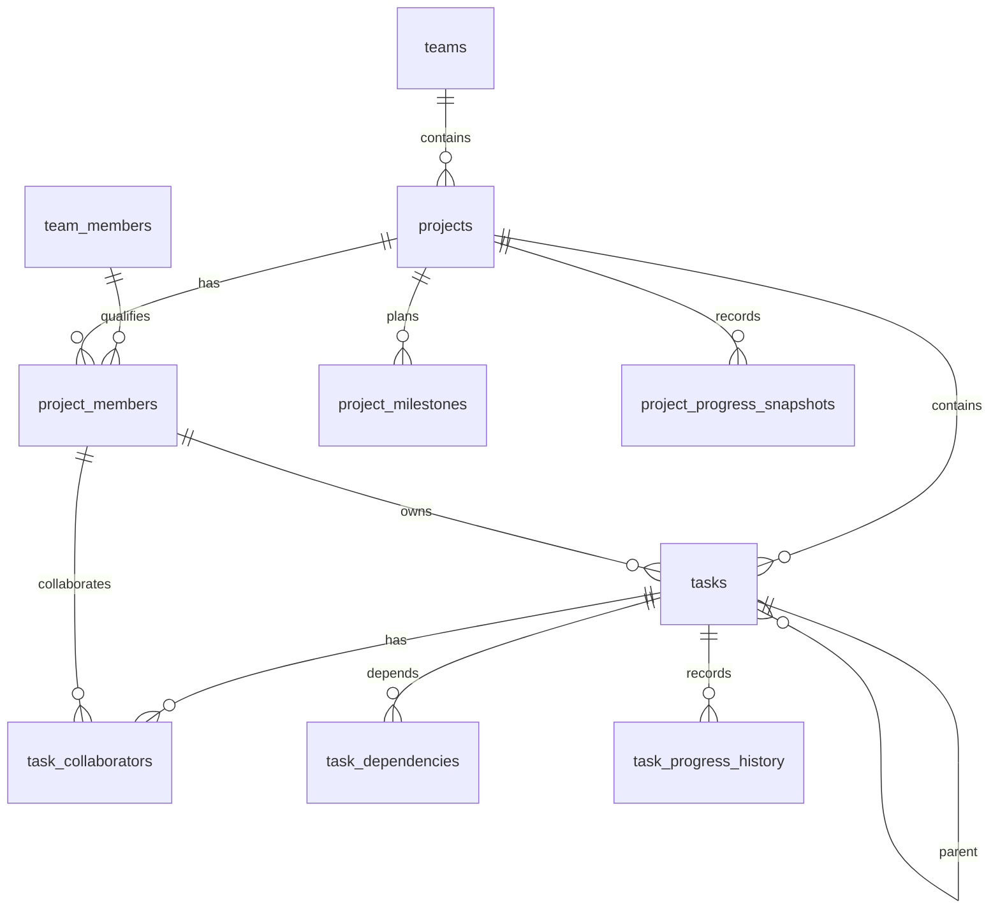

# Phase 03 设计与规则核查

状态：设计基线（2026-11-17，产品负责人 Phase 03 正式任务授权）。实现与验证状态另见最终报告。

## 开工检查

- 重新 fetch 后 develop = `c3fb02923e647f5eccf6a3a9607f49dd75f5904e`，与指定基线无差异；工作区干净。从该提交创建 `feature/phase03-projects-tasks`。
- GitHub 重新查询合并 CI [44097502361](https://github.com/YEXIAONAN/Nexora/actions/runs/44097502361)：Backend、Frontend、Secret scan、Containers 均 success。
- Phase 02 已合并；认证、Cookie/CSRF、Team 实时资格、独立 RBAC、同事务追加式审计可复用。PR #2 的登录 CSRF 与 Team 切换竞态线程均 resolved；开放 Issue 查询为空。这不等于全面渗透测试。
- 已发布迁移为 00001–00003（schema v3）；只追加 00004 项目、00005 任务。运行开发库不执行迁移。只读 `/readyz` 观察到当前开发服务仍报告 version 1（旧运行栈），不将其与已发布源码 v3 混淆；本阶段不升级或重启该栈。
- 沿用 chi/pgx/goose、Vue 3/TS/Pinia、统一信封/request_id、OpenAPI 类型生成、Vitest/Playwright、四 job CI。使用独立无卷 PG17 容器与 testdb 护栏。
- 已完整阅读任务列出的 README、PRD、架构/数据库/权限、ADR 0001/0004/0005/0006、路线图、OpenAPI 与 Phase 02 报告。旧文档中的“PR #2 待合并”为历史快照，以本次远程检查为准。

## 规则冲突与最小假设

1. 原 PRD“进行中按实际进度”由本次批准的有效进度上限 79% 覆盖；待验收固定 80%，Phase 03 不开放该状态。ADR 0005 仅进度 Accepted，金额仍 Proposed。
2. 所有 active Team 成员可查看项目概况、成员与里程碑；任务内容仅项目负责人或该任务的负责人/协作者可读。参与者任务树只返回授权节点，父 ID 可指向未返回节点；UI 将其作为过滤后的根展示，不泄露其他任务内容。
3. 创建项目限 Team owner/admin；创建者自动加入项目，指定负责人必须 active。项目后续管理只限当前项目负责人，Team 高角色不隐式继承；Team owner/admin 可显式受控交接（必须原因与审计）。
4. 负责人交接：当前负责人或 Team owner/admin 将项目交给 active Team 成员（自动加入项目），旧负责人保留参与者身份。任何项目负责人（含归档项目负责人）离开 Team 均拒绝 409，须先显式交接；归档项目不能交接，因此需在归档前完成人员安排。该限制保持归档严格只读。任务负责人离队后保留历史归属，不再拥有有效执行权限；项目负责人必须重新指派 active 项目成员才能继续执行。协作者同理，重新入队不自动恢复项目资格。
5. 项目成员移除为软状态，若仍是非取消任务负责人/协作者则拒绝；先重新分配。Team 移除同步失效该用户项目参与资格，历史保留。
6. 项目状态 active/archived，不开放手动 completed。里程碑为计划节点（名称、说明、计划日期），无假验收/完成动作。无物理删除与批量接口。
7. 父任务是汇总节点：不经叶子状态/进度/权重接口写入；其显示状态和有效进度由后代叶子派生。取消仅作用于叶子，取消父节点需逐一明确取消叶子，避免隐藏批量副作用。已有取消子节点仍属于结构子节点，不使父节点重新计权。
8. 叶转父仅 pending、actual_progress=0、无执行事件且无任何入/出依赖（含已忽略依赖）允许；不会清除历史。父转叶因移出最后一个子节点发生，父自身保留原正整数权重；父没有执行历史，该结构变化必须快照与审计。移动更新整棵子树深度，不允许超过三级或进入自身后代；不能移动已取消节点或挂到已取消节点。
9. 权重为 1–1,000,000 的整数工作量单位；actual_progress 为 0–99 的整数百分比。输出 effective_progress_bps（百分之一百分点）和项目 progress_bps，统一向下取整到 0.01%，不使用浮点。累计用 math/big 保证不溢出；快照保存精确分子/分母十进制字符串。
10. Phase 03 数据库拒绝 awaiting_review/completed/rejected 的写入（仍保留六状态 CHECK 枚举）。未来 Phase 04 必须以新增迁移更换证据约束，并绑定具体成果版本/正式验收记录；不设置假的验收布尔位。

## 模块与并发

`projects` 拥有项目、成员、里程碑及授权事务；`tasks` 拥有任务、协作者、依赖、历史、进度快照。tasks 通过 projects 的授权事务接口获取资源上下文，不跨模块写项目表；teams.Repository 提供团队锁/资格查询。Team 成员退出保护在新增数据库触发器实现，不修改历史迁移。

所有业务读写先锁 teams 行（FOR UPDATE），再查询实时 Team 身份、项目与项目角色、资源状态；沿用 Phase 02 同 Team 串行化，防止成员移除、项目归档、任务结构与依赖竞态。项目/任务修改另用 expected_version 防止用户基于旧页面覆盖新内容（409）。规模取舍：同 Team 的写与业务读串行，适合首版小团队；未来增加吞吐前必须保留锁顺序与资格一致性。

所有 SQL 必带 team_id（项目子资源还带 project_id）。业务修改、审计、任务历史、进度快照共用事务；错误全部回滚。拒绝审计在事务释放后写入，避免 FK 自死锁。历史表禁止 UPDATE/DELETE；FK RESTRICT，无重要历史级联删除。

## ER 与约束

项目、任务 UUID；所有业务/历史表有 team_id。`(team_id,project_id)`、`(team_id,project_id,task_id)` 复合 FK 防跨团队/项目挂接；项目/任务人员复合 FK 指向项目成员及 Team 成员。普通 CHECK 只保证枚举、范围和本行关系。active 资格、树递归无环、深度、依赖环由锁内 Service 校验；数据库结构触发器是额外防线，不能声称普通 CHECK 保证跨行 active 或无环。

## 状态、依赖与计算

- 叶子：pending → in_progress；pending/in_progress → cancelled（必填原因）。其他转换 409，100% 输入 422。父任务显示派生状态，不能通过叶子接口推进。
- A→B 表示 A 依赖 B。只允许同项目的非取消叶子，去重、自环检查和全图 DFS 检环（包含已忽略边，忽略不允许造环）。增加依赖限 pending 任务，避免给进行中任务添加未满足前置条件；被依赖节点可进行中。
- Phase 03 无正式完成证据，所有未忽略依赖均阻塞；B 取消仍阻塞 A。开始、填进度都校验阻塞。
- 忽略仅负责人，具体依赖原行保留 ignored_by/at/reason，必填原因，同事务审计；不改 B 状态、不删除原边。
- 只有结构叶子计权，cancelled 排除；pending 0，in_progress=min(actual,79)，awaiting_review 80（预留纯函数分支，当前不可写），completed 不由 Phase 03 认作已验收，rejected 保守 0（待 Phase 04 重新设计）。空分母输出 0。
- 每次创建/移动/状态/进度/权重变化保存新快照（精确分子、分母、bps、原因、actor、task、request_id、时间），历史不可追溯覆盖。权重事件另保存 old/new、reason、before/after 项目 bps、生效时间；进度历史记录状态、actual、权重和关联审计查询字段。

## 权限矩阵

| 操作 | active Team 成员 | 项目参与者 | 项目负责人 | Team owner/admin |
| --- | --- | --- | --- | --- |
| 项目列表/详情、成员/里程碑、项目进度/快照 | 是 | 是 | 是 | 是 |
| 创建项目 | 否 | 否 | 依 Team 角色 | 是 |
| 编辑/归档、成员/里程碑、任务结构/分配/权重/依赖 | 否 | 否 | 是 | 需本身是项目负责人 |
| 任务读取/执行历史 | 否 | 仅负责/协作的任务 | 全部 | 需项目授权 |
| 开始、实际进度 | 否 | 仅负责/协作且有效成员 | 是（执行人员须有效） | 需项目授权 |
| 取消 | 否 | 仅任务负责人 | 是 | 需项目授权 |
| 显式负责人交接 | 否 | 否 | 是 | 是（原因与审计） |

ROOT/平台管理员不绕过上述规则；跨 Team 或项目资源不存在统一 404，权限不足 403、状态/旧版本 409、输入非法 400/422。归档项目一律只读。

## 接口与验收计划

完整 Contract First 设计见 `docs/api/openapi.yaml`：项目、成员、交接、里程碑、任务树/详情/编辑/移动/状态/进度/权重、依赖/忽略、执行历史与进度快照。所有变更使用 CSRF、自会话推导 actor，URL 固定 Team/Project，拒绝请求体覆盖资源归属。

依次 M2 项目 → M3 任务 → M4 依赖与进度 → M5 Vue → M6 全门禁、真实 PG 并发/回滚与浏览器 E2E、PR/CI/请求审查。按阶段普通 Conventional Commits；不触碰 main/develop，不自动合并。

实现收尾：任务图缓存非叶子节点集合，结构变动后失效重建，避免每次叶子判断扫描全图。任务动作在负责人离队后要求先重新分配（409），避免触发器校验失败映射为 500。历史时间与更新时间使用 clock_timestamp()；快照 numeric 用整数文本 CHECK 排除 NaN、Infinity 与小数。
