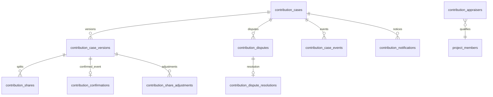

# Phase 05 贡献核算 M1 最终设计冻结（Accepted）

- 日期：2026-11-18
- 状态：**Accepted**。产品负责人于 2026-11-18 明确“批准 M1，启动 M2”，18 项最终治理规则生效；仅授权 M2 数据库开发，不推进 API、Vue 或奖金。
- 基线：develop `07f6fa1c201a2257e768a0ab24b27fb8804081f0`（PR #4 合并），Schema v6（迁移 00001–00006），PR #4 合并 CI 44202649641 四项成功；`main` `36bddd6` 未修改。
- 范围：V1.1 贡献核算——证据整理、人工份额草案、独立核定、异议与修订、项目参与统计。
- 不在范围：奖金方案/金额/币种/支付（Phase 06；ADR 0005 金额仍 Proposed）；跨任务价值权重与综合贡献指数；自动精确百分比推断。
- 批准记录：[ADR 0007](../architecture/adr/0007-contribution-governance.md)。下文旧提案标签和批准模板属于候选原稿；全部 18 项规则现为 Accepted，以本次正式任务及 §18 澄清为准。ADR 0005 金额部分仍 Proposed。

## 1. 目标与不可谈判边界

1. 贡献核算只以**当前正式验收证据**为入口：`tasks.status='completed'` 且 `accepted_review_id` 指向当前成果版本的 `approve` 审核。
2. 未验收、待验收、驳回、取消、草案、待核定、争议中的未决版本，**一律不得进入正式统计**。
3. 不把任务负责人、当前协作者、成果提交者、附件上传者、审核人、任务权重、代码行数、提交次数、在线时长直接换算为贡献比例。
4. V1.1 不自动推断精确贡献百分比；只提供证据整理、人工草案与一致性校验。
5. 贡献核算不产生金额、不引入奖金分配算法；奖金属 Phase 06，金额规则仍未批准。
6. 归档项目只读；旧归档项目不因升级 v7 被隐式修改或回填。

## 2. 四层模型（历史确认与当前有效性分离）

| 概念 | 字段/表 | 语义 | 使用约束 |
| --- | --- | --- | --- |
| 最新工作版本 | `contribution_cases.latest_version_id` | 当前最新版本（draft/pending_review/confirmed/superseded/overturned/abandoned） | **仅用于工作流**；正式统计禁止读取 |
| 当前正式有效版本 | `contribution_cases.effective_confirmed_version_id` | 当前正式生效的已确认版本；无则 NULL | **正式统计唯一读取此指针** |
| 案例工作流状态 | `contribution_cases.case_workflow_status` | draft / pending_review / confirmed / disputed / revising / abandoned | 由权威状态派生并由数据库校验；客户端不可写 |
| 不可变确认事件 | `contribution_confirmations`（每版本唯一） | 某版本被正式核定的历史事实（confirmed_by、时间、理由、内容摘要） | 只追加；禁止 UPDATE/DELETE |
| 失效事件 | 版本状态 `superseded` / `overturned` + `contribution_case_events` | 被新正式版本取代 / 被正式裁定推翻 | 二者语义分离，**不得用 revised 混用** |

规则：

- 新修订草案只推进 `latest_version_id`；`effective_confirmed_version_id` 保持不变，统计继续使用旧有效版本。
- 新版本核定成功后，在同一事务内：插入不可变确认事件 → 旧有效版本置 `superseded` → 新版本置 `confirmed` → 更新有效指针 → 追加案例事件与审计。失败全部回滚。
- 正式裁定推翻时，在同一事务内：插入不可变裁定记录 → 有效指针清空 → 被推翻版本置 `overturned` → 原子生成后续修订草案（`supersedes_version_id` 指向被推翻版本）→ 更新 `latest_version_id` → 追加事件与审计。
- 确认事件与裁定记录是**不可变历史事实**；争议、修订、翻转均不得修改或删除它们。
- `confirmed_by` 是不可变的应用级确认记录，**不是密码学数字签名**；不得把普通操作日志冒充签名或不可抵赖证明。

## 3. 唯一核算入口（实际约束，不引用 VIEW）

- 允许来源：`task_acceptance_evidence` 所对应的 `review_id` 与 `submission_version_id`。
- **不得对 PostgreSQL VIEW 建外键**。案例通过复合外键指向基础表：
  - `(team_id, project_id, task_id, submission_version_id)` → `task_submission_versions(team_id, project_id, task_id, id)`；
  - `(team_id, project_id, task_id, submission_version_id, review_id)` → `task_reviews(team_id, project_id, task_id, submission_version_id, id)`；
  - `(team_id, project_id, task_id)` → `tasks(team_id, project_id, id)`。
- 另以 **DEFERRABLE 约束触发器**（提交时校验，查询基础表，不查视图）验证：
  1. `tasks.status = 'completed'`；
  2. `tasks.accepted_review_id = review_id`；
  3. `tasks.current_submission_version_id = submission_version_id`；
  4. `task_reviews.decision = 'approve'`；
  5. Team/Project/Task 一致。
- 一个 `review_id` 至多一个案例：`UNIQUE(team_id, project_id, task_id, review_id)`；创建使用幂等插入并返回既有案例。
- 视图仅用于读取便利；禁止把视图当作完整性约束。

## 4. 角色、成员资格与证据可信度边界

### 4.1 角色严格分离【Accepted】

| 角色 | 数据来源 | 是否等同贡献者 | 正确用途 |
| --- | --- | --- | --- |
| 成果提交者 | `task_submission_versions.author_id`（不可变） | 否 | 客观事实：作者行为；**不换算比例** |
| 任务负责人 | `tasks.owner_id`（完成后冻结） | 否 | 客观事实：分配归属；**不换算比例** |
| 协作者 | `task_collaborators`（编辑时整组 DELETE/INSERT，**无历史**） | 否 | 仅当前上下文提示；**不得作为历史依据或比例** |
| 审核人 | `task_reviews.reviewer_id`（不可变） | 否 | 治理事实；**不进入份额计算** |
| 附件上传者 | `submission_attachments.uploader_id`（绑定后不可变） | 否 | 客观事实：上传行为；**不换算比例** |
| 实际贡献者 | 无自动真值 | — | 由证据 + 自述 + 佐证 + 人工核定确定 |
| 贡献核定人 | `contribution_appraisers` 显式授权 | — | 人工独立核定；不因任何既有角色自动获得 |

### 4.2 成员资格与虚构成员禁止【Accepted】

- 份额持有人必须引用**真实存在的** `project_members` 行（当前 active 或历史 removed）。`project_members` 为软删除，历史行保留。
- **不得为满足外键而插入虚构成员关系**；没有项目成员历史的人不能成为正式份额持有人。其贡献只能作为叙述性证据，不产生正式份额（如产品确需纳入，须另行批准，不得私自补行）。
- 确认时快照 `membership_state`：`active` 或 `historical`，用于展示与覆盖统计。
- 历史参与证据集合（用于覆盖分母）明确限定为：`project_members` 曾存在的用户 ∪ 已验收版本作者 ∪ 已绑定附件上传者；**协作者名单因无历史不纳入**。

### 4.3 证据可信度边界【Accepted】

| 证据类别 | 来源 | 可信度定位 | 明显局限 | 允许用途 | 禁止用途 |
| --- | --- | --- | --- | --- | --- |
| 客观行为事实 | 作者、附件上传者、审核人、任务完成/负责人 | 事实可靠（不可变或完成后冻结） | 行为≠贡献比例；作者可能代表团队输出；负责人是分配 | 候选提示、证据引用、时间线 | 直接换算百分比 |
| 客观-协作者名单 | `task_collaborators` | 低：编辑时替换，无历史 | 早期协作者可能已消失；不代表实际贡献 | 仅当前上下文提示 | 作为历史依据或比例 |
| 个人贡献声明 | 候选人自述 + 证据引用 | 未经核实、自利 | 可能夸大/遗漏 | 草案输入，标注“自述” | 当作已证实事实 |
| 第三方佐证 | 其他成员陈述/背书 | 未核实 | 可能有从属或串谋 | 辅助参考，标注“佐证” | 当作权威结论 |
| 人工核定意见 | 核定人理由 + 最终份额 | 权威决定但主观 | 依赖核定人独立性 | 正式核定依据 | 声称算法客观精确 |
| 禁止输入 | 任务权重、代码行数、提交次数、在线时长 | — | 与个人贡献无确定映射 | 仅可背景展示（不参与计算） | 任何比例计算 |
| 禁止映射 | 任意角色身份 → 贡献得分 | — | 角色≠贡献 | — | 直接生成份额 |

- 每条证据必须展示来源与局限标签。
- 一致性校验仅检查：合计=10000、份额范围、候选成员真实、冲突规则、声明/证据完整性；**不计算推荐百分比**。
- 证据不足或草案不完整时保持 draft，明确提示“需人工核定”。

## 5. 完整状态机

### 5.1 版本生命周期（6 态，不包含 revised）

| 版本状态 | 语义 | 可编辑性 |
| --- | --- | --- |
| `draft` | 草案 | 份额/证据可编辑；合计可≠10000 |
| `pending_review` | 已提交待核定 | 内容冻结；合计必须=10000 |
| `confirmed` | 已正式核定 | 完全不可编辑；可成为有效版本 |
| `superseded` | 被新的正式核定版本取代 | 终态；确认事件保留，历史保留 |
| `overturned` | 被正式裁定推翻 | 终态；确认事件保留，历史保留 |
| `abandoned` | 草案被明确放弃 | 终态；无正式效力；必须审计 |

合法转换：

| 从 → 到 | 动作 | 条件 |
| --- | --- | --- |
| draft → pending_review | 提交 | 合计=10000；候选/证据合法 |
| pending_review → draft | 撤回 | 提案人；未确认 |
| pending_review → confirmed | 核定 | 单名独立核定人；COI 全通过 |
| draft → abandoned | 放弃草案 | 仅 draft；必填原因；审计 |
| confirmed → superseded | 被新版本取代 | 仅在新版本核定的同一事务内 |
| confirmed → overturned | 被裁定推翻 | 仅在推翻裁定的同一事务内 |
| superseded / overturned / abandoned | 终态 | 不可再转换 |

### 5.2 案例工作流状态（派生 + 数据库校验）

派生优先级：`disputed` > `revising` > `confirmed` > `pending_review` > `abandoned` > `draft`。

| 状态 | 派生条件 |
| --- | --- |
| `disputed` | 有效版本存在且存在未决争议 |
| `revising` | 有效版本存在、最新版本为活动修订（draft/pending_review 且 ≠有效）、无未决争议 |
| `confirmed` | 有效版本存在、最新=有效或修订草案已放弃、无未决争议 |
| `pending_review` | 无有效版本、最新为 pending_review |
| `abandoned` | 无有效版本、最新为 abandoned |
| `draft` | 其余（无版本/最新为 draft） |

- 该状态由触发器根据权威字段派生并存储；**数据库约束触发器校验其正确性；API 不接受客户端写入**。
- 正式统计只认 `confirmed`（且无未决争议、读取有效指针）。

### 5.3 事务不变量

| 事务 | 不变量 |
| --- | --- |
| T1 核定 | 插入确认事件、版本 confirmed、有效指针更新、旧有效版本 superseded、事件与审计，全部同一事务；失败全回滚 |
| T2 取代 | 仅发生在 T1 内；旧版本 superseded 必须有更新的 confirmed 版本 |
| T3 推翻 | 裁定记录 + 有效指针清空 + 版本 overturned + 新 draft（supersedes 指向被推翻版本）+ latest 更新 + 事件 + 审计，同一事务 |
| T4 维持 | 仅追加裁定记录；有效指针与版本状态不变；工作流重算 |
| T5 发起争议 | 仅追加争议记录；不修改确认事件；工作流重算为 disputed |
| T6 放弃草案 | 仅 draft；版本 abandoned；事件 + 审计；有效指针不变 |
| T7 创建修订 | 新 draft + supersedes + latest 更新 + 事件 + 审计；有效指针不变 |
| T8 统计读取 | 只读；仅 `effective_confirmed_version_id` 且 status=confirmed 且无未决争议 |

## 6. ER 结构



| 表 | 关键列 | 关键约束/触发器 |
| --- | --- | --- |
| `contribution_appraisers` | team,project,user,member_authorization_version,status,granted_by,reason,version | PK(team,project,user)；FK→project_members；**CHECK(granted_by<>user_id)**；授权/撤销审计 |
| `contribution_cases` | id,team,project,task,review_id,submission_version_id,latest_version_id,effective_confirmed_version_id,case_workflow_status | **UNIQUE(team,project,task,review_id)**；复合 FK→基础表；延迟触发器校验验收事实；两指针须同案例 |
| `contribution_case_versions` | id,case_id,version,status,supersedes_version_id,proposed_by/at,submitted_at,evidence_snapshot,client_request_id | UNIQUE(case_id,version)；UNIQUE(case_id,supersedes_version_id)；**仅 draft 可改内容**；状态转换触发器 |
| `contribution_shares` | id,case_version_id,user_id,share_bps,basis,statement,evidence_refs,membership_state | UNIQUE(case_version_id,user_id)；FK→project_members；仅父版本 draft 可写；`share_bps` 1–10000 |
| `contribution_share_adjustments` | case_version_id,user_id,old_bps,new_bps,reason,actor,request_id | 追加式；reason 非空 |
| `contribution_confirmations` | id,case_version_id UNIQUE,confirmed_by,confirmed_at,rationale,version_digest,request_id | **不可变**；单名核定人；COI 由触发器最终校验 |
| `contribution_disputes` | id,case_id,case_version_id,raised_by,on_behalf_of,verification_method,verification_evidence_ref,verification_note,reason | **不可变**；代提时 method+evidence_ref 必填，自由文本仅为补充 |
| `contribution_dispute_resolutions` | dispute_id UNIQUE,decision(uphold/overturn),resolved_by,reason,request_id | **不可变**；裁定人独立 |
| `contribution_case_events` | case_id,case_version_id,event,from_status,to_status,actor,reason,request_id | 追加式；记录核定/取代/推翻/放弃/争议/修订 |
| `contribution_notifications` | case_id,case_version_id,recipient_id,channel,evidence_type,evidence_ref,evidence_digest,sent_at,acknowledged_at | 追加式；归档前告知证据 |

说明：

- 不引入多人签名表；V1.1 单名独立核定人 + 不可变确认记录（`confirmed_by`）。
- 统计数据通过只读视图/查询集中定义：仅有效确认版本且无未决争议；**视图不用于外键**。
- 复合外键贯穿 `(team_id, project_id, task_id)`；无跨 Team/Project 挂接。
- 版本内容列在离开 draft 后不可 UPDATE；状态位仅允许 §5.1 的转换。
- 份额与调整仅在父版本 draft 可写；提交后冻结。
- 所有历史/事件/确认/争议/通知表禁止 UPDATE/DELETE（复用追加写触发器模式）。

## 7. 数据库不变量（可测试）

| # | 不变量 |
| --- | --- |
| I1 | `effective_confirmed_version_id` 为 NULL 或指向本案例 status=confirmed 且存在确认事件的版本 |
| I2 | `latest_version_id` 单调递增且指向本案例最大版本；永不回退 |
| I3 | 核定只能针对 `latest_version_id` 且 status=pending_review 的版本 |
| I4 | `superseded` 只能由更新版本的确认事务产生，且存在后继 confirmed 版本 |
| I5 | `overturned` 必须存在 overturn 裁定；有效指针被清空；同一事务生成新 draft |
| I6 | 每个 `case_version_id` 至多一条确认事件；确认事件/裁定记录不可变 |
| I7 | 版本内容离开 draft 后不可变；份额仅在父版本 draft 可写 |
| I8 | 提交与核定时 `SUM(share_bps)=10000` 且份额持有人≥1 |
| I9 | 核定人须 active Team+Project 成员、有效核定授权、非受益人、非提案人、无其他直接 COI |
| I10 | 核定授权禁止自我授权（granted_by≠user_id） |
| I11 | 正式统计只读有效指针，排除未决争议；草案/待核定永不计入 |
| I12 | 归档转换必须覆盖项目全部正式验收证据并具备告知证据；归档后贡献表只读 |
| I13 | `case_workflow_status` 由权威字段派生并被数据库校验；客户端不可写 |
| I14 | 份额持有人必须引用真实 `project_members` 行；禁止虚构成员 |
| I15 | 争议/裁定/事件/通知/调整追加写，禁止 UPDATE/DELETE |
| I16 | 不对 VIEW 建外键；验收一致性由基础表复合外键 + 延迟触发器证明 |
| I17 | v7 迁移不修改 00001–00006，不修改旧归档项目，不自动建案/回填 |

## 8. 权限与利益冲突矩阵

### 8.1 核定授权

- 项目负责人向**其他有效项目成员**授予贡献核定权；必填原因、写审计、绑定 `project_members.authorization_version`；撤销立即生效；重新加入不复活。
- **禁止自我授权**；ROOT、Team owner/admin 不自动取得项目核定权。
- 项目负责人自身的核定授权须由其他授权者作出（Team owner/admin 或另一授权者；具体授权者范围待批准）。

### 8.2 V1.1 独立核定人（单名）

必须同时满足：

1. 有效 Team 成员；
2. 有效 Project 成员；
3. 有效且未过期的贡献核定授权（epoch 匹配）；
4. 本次份额分配中份额 = 0（非直接受益人）；
5. 不是本次分配提案人；
6. 无其他应披露的直接利益冲突（含：被验收版本作者、该任务审核人、其他已披露直接利益）。

不满足任一条件即无资格；无人符合时保持 `pending_review`，**不得由 ROOT/Team owner/admin/平台权限绕过**。

### 8.3 权限矩阵

| 操作 | 受益人（份额>0） | 提案人（非受益人） | 独立核定人 | 独立裁定人 | 项目负责人 | Team owner/admin | ROOT/平台管理员 | 离队者 |
| --- | --- | --- | --- | --- | --- | --- | --- | --- |
| 提供贡献声明 | 是（本人） | 是 | 是 | 是 | 是 | 否 | 否 | 经代提 |
| 提议/调整草案 | 否 | 是 | 是 | 否 | 是 | 否 | 否 | 否 |
| 提交待核定 | 否 | 是 | 是 | 否 | 是 | 否 | 否 | 否 |
| 核定 | **否** | **否（不得唯一/不得签名）** | 是 | 否 | 仅获授权且非受益/非提案 | 否 | **否** | 否 |
| 裁定争议 | 否 | 否 | 否（原核定人回避） | 是 | 仅获授权且独立 | 否 | 否 | 否 |
| 发起异议 | 是（本人相关） | 是 | 是 | 否 | 是 | 仅项目成员时 | 否 | 经代提 |
| 放弃草案 | 否 | 是（提案人） | 是 | 否 | 是 | 否 | 否 | 否 |
| 查看案例/统计 | 本人相关 | 项目范围 | 项目范围 | 项目范围 | 项目范围 | 仅项目成员时 | 否（404） | 否 |

补充：

- 项目负责人双重身份：业务负责人可建案、整理证据、授权他人；若本人份额>0，则作为受益人回避核定与裁定，业务身份不豁免。
- 审核人/任务负责人：无自动核定权；若获授权且非受益人、非提案人、无其他直接 COI，可核定。

## 9. 份额核定流程

1. **建案**：从验收 `review_id` 幂等创建案例与 draft v1；有效指针=NULL。
2. **证据整理**：展示客观事实、自述、佐证及局限；候选仅为提示。
3. **人工草案**：获授权者手工录入份额与理由；调整逐条追加（前值/后值/原因）。
4. **提交**：合计=10000、候选/证据合法；版本冻结为 pending_review。
5. **核定**：单名独立核定人（§8.2）在团队锁 + 案例锁内复核；同事务写确认事件、切换有效指针、旧版本 superseded、审计。
6. **事后**：统计只读有效版本；争议可追加；修订创建新版本，未确认前不改变有效指针。
7. **阻塞**：无独立核定人 → 保持待核定；不自动放行。

## 10. 争议、代提与离队

- **无自动失权期限**：V1.1 不设计“7 天未送达即失权”；争议持续开放直至裁定。
- **发起**：有效项目成员/贡献者/项目负责人可提异议，必填理由；记录 `raised_by` 与请求 ID。
- **回避**：原核定人不得裁定；受益人不得裁定。
- **独立裁定**：另一名合格核定人（非受益人、非原核定人、无其他直接 COI）裁定维持/推翻；不可变裁定记录。
- **无独立裁定人**：保持 disputed 未决；不自动裁决、不平台绕过。
- **推翻**：清空有效指针、版本 overturned、原子生成修订草案；新版本确认前不进入正式统计。
- **不可覆盖**：争议、裁定、确认事件均保留。
- **离队**：已确认贡献按 Team 隔离保留；离队者无 Team 数据访问权（404），不得作为提案人/核定人/裁定人；新案例可由在岗独立核定人包含其历史份额。
- **代提异议**：授权人员可在**验证身份与请求来源**后记录 `on_behalf_of`；必须填写结构化 `verification_method` + `verification_evidence_ref`；`verification_note` 仅为补充，**不得单独作为核验成功证明**；不向离队者开放数据回传通道。

## 11. 归档完整性、告知与旧归档兼容

### 11.1 归档前检查必须覆盖全部正式验收证据

归档事务（active→archived）必须枚举项目全部 `task_acceptance_evidence` 对应任务，并逐项确认：

| 状态 | 归档 |
| --- | --- |
| 已验收但**尚未建立贡献案例** | **禁止**（不得视为核算完成） |
| 草案未提交 | **禁止**；放弃不能替代核算 |
| 等待独立核定 | **禁止** |
| 已确认但存在未决争议或活动修订 | **禁止** |
| 正式确认且无未决争议、无活动修订 | 允许 |
| 被推翻且尚无新确认版本 | **禁止** |

- 任何遗漏都不得被误判为“贡献核算已结束”。
- 归档检查由 Service 强制 + 数据库触发器兜底（查询基础表/验收事实，不依赖已建案例列表）。
- abandoned 仅是草案生命周期；对应验收成果仍无有效确认时继续阻止归档。放弃必须有原因和审计。

### 11.2 归档前告知（可审计）

- 归档前必须对每个已确认案例的每位份额持有人记录可审计告知：接收人、渠道、结构化送达证据（`evidence_type` + `evidence_ref` + `evidence_digest`）、发送时间；可选确认时间。
- 离队成员通过受控渠道记录告知与送达证据。
- **缺少告知证据或存在未决异议时禁止归档。**
- 告知是“已通知”的证据，不是同意；不得以自由文本代替送达证据。

### 11.3 归档后与旧归档项目

- 归档后贡献相关写操作（建案/编辑/提交/核定/争议/放弃/修订/通知）全部拒绝；历史与已确认记录可查。
- 归档后新发现争议：普通业务接口禁止写入；需另行批准的受控管理流程（本期不设计、不实现），并明确记录残余风险。
- **旧归档项目**：v7 升级不改其状态、不自动建案、不回填；历史原样保留。
- **禁止**以普通业务接口绕过归档保护；如需历史回填，须单独批准的受控数据迁移（非普通 API，带审计/回滚），本期不执行。

## 12. 项目级统计（无综合指数）

仅提供（只读，只基于有效确认版本且无未决争议）：

| 指标 | 口径 |
| --- | --- |
| 已确认贡献案例数 | 有效指针存在、版本 confirmed、无未决争议 |
| 各案例成员份额 | 逐案例列出 share_bps（10000=100%） |
| 参与覆盖（当前成员） | 有确认份额的 active 项目成员 / 当前 active 项目成员 |
| 参与覆盖（历史成员） | 有确认份额的历史参与证据成员 / 项目历史参与证据成员（限定集合见 §4.2） |
| 待核定案例数 | 无有效版本且 pending_review；或活动修订待核定 |
| 争议案例数 | 未决争议数 |
| 修订历史 | 版本链、确认事件、争议/裁定、状态 |

- **不**将各任务份额相加或取平均生成“个人项目贡献指数”。
- **不**乘任务权重、**不**换算金额、**不**排序评价。
- 修订中的旧有效版本可计入但必须标注“修订进行中”；新草案/待核定永不计入。
- 未来跨任务综合分数须独立批准价值权重与算法，另行设计。

## 13. v7 迁移与回归测试计划（仅计划，不创建迁移）

### 13.1 迁移 00007_contributions.sql

- 只新增，不修改 00001–00006；不修改旧归档项目。
- 新建：`contribution_appraisers`、`contribution_cases`、`contribution_case_versions`、`contribution_shares`、`contribution_share_adjustments`、`contribution_confirmations`、`contribution_disputes`、`contribution_dispute_resolutions`、`contribution_case_events`、`contribution_notifications`；归档保护触发器、统计只读视图/查询。
- Down：存在任何贡献业务数据时**拒绝回滚**（fail-closed），避免删除不可变历史；空库可回滚。
- 索引：`(team,project,status)`、`(case_id,version)`、`(case_version_id)`、`(case_id,created_at)` 等，按真实查询建立。

### 13.2 迁移验证

- v6 空库 → v7；v6 含 Phase 03/04 数据（任务、成果版本、审核、归档项目）→ v7：现有表行数与内容摘要前后一致，**不自动建案、不修改旧归档项目**。
- v7 空库 down → v6；v7 有贡献数据 down → 拒绝并保留 v7。
- `goose` 幂等、随机 schema 隔离、testdb 护栏不放宽。

### 13.3 回归测试矩阵

| 类别 | 测试 | 期望 |
| --- | --- | --- |
| 入口/幂等 | 同一 review_id 重复/并发；旧版本/驳回/伪造 review | 返回同一案例；非法来源拒绝 |
| 验收约束 | 基础表校验（非 completed、非当前版本、非 approve、跨 Task） | 数据库拒绝；不依赖 VIEW 外键 |
| 版本模型 | 修订 draft/pending 不改变有效指针与统计 | 统计只读旧有效版本 |
| 版本模型 | 修订确认原子切换；故障注入 | 指针/状态/确认/审计整体回滚 |
| 失效语义 | superseded 仅由新确认产生；overturned 仅由裁定产生 | 二者不可混用 |
| 推翻 | 指针清空 + 新 draft 同事务；统计排除 | 不出现未确认数据入统计 |
| 放弃 | 仅 draft 可放弃；审计；修订草案放弃后有效版本仍有效 | 通过/拒绝正确 |
| COI | 受益人、提案人、作者/审核人利益、无授权、自授 | 拒绝核定 |
| COI | ROOT/Team owner/admin 无授权 | 403，无绕过 |
| COI | 无独立核定人 | 保持 pending |
| 证据 | 角色/权重/行数/提交数/时长 | 不生成份额 |
| 证据 | 协作者名单局限展示；自述/佐证标签 | 正确标注 |
| 成员资格 | 历史成员保留；无 project_members 行 | 可引用历史行；拒绝虚构 |
| 份额 | 提交/核定合计≠10000、负数、超限 | 拒绝 |
| 状态机 | 全部合法/非法转换；确认后改内容 | 非法 409；确认后不可改 |
| 统计 | draft/pending/disputed/superseded/overturned 排除 | 只计有效 confirmed 且无争议 |
| 统计 | 覆盖分母（当前/历史） | 标签与数值正确 |
| 归档 | 全部验收证据覆盖；缺案例/草案/待定/争议/活动修订 | 拒绝归档 |
| 归档 | 告知证据缺失 | 拒绝归档 |
| 归档 | 旧归档项目升级 v7 | 状态/数据不变 |
| 归档 | 归档后贡献写入 | 拒绝 |
| 争议 | 发起/回避/独立裁定/无裁定人 | 正确 |
| 代提 | 结构化核验；仅自由文本 | 拒绝代提 |
| 离队 | 历史保留；无访问；不可核定；代提渠道 | 正确 |
| 并发 | 双核定/核定+推翻/争议+统计/放弃+归档 | 事务一致 |
| 审计 | 故障注入 | 全回滚 |
| API | 认证/CSRF/404/403/409/422/幂等 | 统一信封 |
| 前端 | 客户端不能写 case_workflow_status；竞态 | 拒绝/隔离 |
| E2E | 验收→建案→草案→提交→核定→争议→推翻→修订 | 真实栈通过 |

## 14. 原 M1 18 项决策表（Accepted / 待批准 / 调整结果）

> 2026-11-18 产品负责人已批准以下全部 18 项最终修订规则；原候选中的待批准状态已由本次授权取代。

| # | 原决策 | 状态 | 本轮调整结果 |
| --- | --- | --- | --- |
| 1 | 任务级份额基数 10000，提交/核定合计=10000 | Accepted | 不变 |
| 2 | V1.1 不自动推断百分比，仅证据整理+人工草案+一致性校验 | Accepted | 强化：移除任何自动建议字段/算法 |
| 3 | 证据四分类与禁止输入清单 | Accepted | 补充协作者无历史、成员资格限制 |
| 4 | 受益人严格回避 | Accepted | 不变（无双重控制例外） |
| 5 | 提案人不得唯一核定 | Accepted | V1.1 简化为单名独立核定人，且不得为提案人 |
| 6 | 核定授权者范围 | Accepted | 项目负责人授予其他成员；ROOT/Team owner/admin 不自动 |
| 7 | 项目负责人自身授权由谁作出 | Accepted | 建议 Team owner/admin 或另一授权者 |
| 8 | 单签名 vs 多签名 | Accepted | V1.1 单名独立核定人；不引入多人签名体系 |
| 9 | 无独立核定人兜底 | Accepted | 保持待核定，不设平台例外 |
| 10 | 争议发起人范围 | Accepted | 有效项目成员/贡献者/负责人；离队经代提 |
| 11 | 争议时限 | Accepted | 取消自动失权窗口 |
| 12 | 代提异议与核验 | Accepted | 结构化 method+evidence_ref；自由文本不作证明 |
| 13 | 草案是否阻塞归档 | Accepted | 全部验收证据覆盖；草案须显式放弃 |
| 14 | 旧归档项目回填 | Accepted | 保留历史；v7 不隐式修改；普通 API 禁止回填 |
| 15 | 项目统计口径 | Accepted | 无综合指数；计数+逐案份额+双覆盖分母 |
| 16 | 未来跨任务综合指数 | Accepted | 另行独立批准，不属 V1.1 |
| 17 | 修订可下调已确认份额 | Accepted | 经新版本+重新核定 |
| 18 | 归档后补记争议 | Accepted | 归档前告知；归档后普通接口禁止 |

本轮新增待批准事项：superseded/overturned 语义分离；abandoned 终态；归档前可审计告知与送达证据标准；成员资格/历史覆盖分母；基础表验收约束（不引用 VIEW）；case_workflow_status 派生校验；归档前全量验收证据检查。

## 15. 产品负责人批准记录模板

> 仅产品负责人可批准；不得默认批准；逐项记录。批准后由 M2 依据本记录实施。

```markdown
# Phase 05 产品规则批准记录

- 设计文件版本：docs/development/phase-05-design.md（设计冻结候选，2026-11-18）
- 批准人（产品负责人）：
- 批准日期：
- 批准方式/记录位置：

| 规则 ID | 决策（批准/拒绝/修改） | 修改内容或条件 | 备注 |
| --- | --- | --- | --- |
| P05-01 份额基数与合计 |  |  |  |
| P05-02 不自动推断百分比 |  |  |  |
| P05-03 证据分类与禁止输入 |  |  |  |
| P05-04 受益人回避 |  |  |  |
| P05-05 单名独立核定人 |  |  |  |
| P05-06 核定授权者范围 |  |  |  |
| P05-07 项目负责人自身授权 |  |  |  |
| P05-08 无独立核定人处理 |  |  |  |
| P05-09 争议发起与代提 |  |  |  |
| P05-10 无自动失权 |  |  |  |
| P05-11 草案放弃 |  |  |  |
| P05-12 归档前全量检查 |  |  |  |
| P05-13 归档前告知证据 |  |  |  |
| P05-14 旧归档项目兼容 |  |  |  |
| P05-15 项目统计口径 |  |  |  |
| P05-16 修订下调已确认份额 |  |  |  |
| P05-17 归档后争议处理 |  |  |  |

结论：□ 全部批准  □ 部分批准（见上表）  □ 需再次修订

签字/记录引用：
```

## 16. 文档过期状态同步（本轮修正，不改写历史验收报告）

本轮同步修正以下过期 Phase 03/04 状态描述（历史验收报告 phase-02/03/04-report.md 保持原样，不作改写）：

- `README.md`：Phase 01–03 → Phase 01–04 已合并；Phase 04 待合并 → 已合并（PR #4 / `07f6fa1c`）。
- `docs/product/product-requirements.md`：当前工程阶段、Phase 03 PR #3 未合并、Phase 04 未实现、实现跟踪增补。
- `docs/development/roadmap.md`：Phase 04 待合并、当前交付跟踪。
- `docs/architecture/permissions.md`：Phase 04 待合并标记（并注明 Phase 05 权限矩阵待批准）。
- `docs/architecture/database.md`：Phase 04 Schema v6 待合并标记（并注明 v7 设计待批准）。
- `docs/architecture/system-architecture.md`：Phase 02 扩展待合并、Phase 03 PR #3 未合并、Phase 04 状态。
- `docs/api/README.md`：Phase 04 本次分支标记。

## 17. 交付边界

本轮只完成：本设计文件、修订后的 ER/状态机、数据库不变量与权限矩阵、归档/异议/独立核定边界、v7 迁移与回归测试计划、产品负责人批准记录模板、文档过期状态同步。

**未做**：未创建迁移、未修改业务代码/API/前端、未创建 PR、未合并、未修改 `main`/`develop`、未启动 M2。等待产品负责人按 §15 记录正式确认后，再启动 M2。

## 18. 2026-11-18 批准记录与 M2 实施澄清

批准角色：产品负责人；日期：2026-11-18；原文：“批准 M1，启动 M2。”范围为 §14 最终修订的全部 18 项规则。附加门禁为可核查送达、放弃不能绕过核算、保护历史和本地工作区。§15 模板与 §17 未启动声明仅保留为批准前历史，不再代表当前状态。金额部分仍 Proposed。M1 原稿及所有原未提交差异已备份到 .cache/phase05-m2-preflight。

- 本地没有单独命名的“贡献治理最终整改报告”；已核对本设计 §14/§16/§17 整改内容及本次完整正式任务，未虚构来源。
- 放弃草案不意味着核算完成；结果告知的自由文本引用/摘要也不能单独证明送达。
- 修订中仍读取旧有效确认份额并标注 revising；新草案不入统计，未决争议排除正式结果。
- 核定授权：负责人授予其他有效成员；负责人自身由有效项目成员中的 Team owner/admin 或已有显式核定授权者授予。授权操作权不等于核定权，任何人不得自授。
- 一案仅一个活动 Draft/Pending；用活动版本部分唯一索引替代阻止放弃后再次修订的无条件 supersedes 唯一约束。
- 推翻时已有未确认修订，裁定事务将其标记 abandoned 并保留全部内容；Pending 的内部退役仅限此 overturn，随后原子创建指向被推翻版本的新 Draft。不改变任何未确认份额的正式效力。
- 送达只准备未满足记录。M2 的最小核验基础是收件人持有既有有效会话令牌并明确确认具体核定摘要，服务端计时并存会话/身份引用；原始令牌不落库。人工通知或“创建通知”不能归档。M3 尚需受控发送/确认入口，本次没有 Phase 07 通知系统。
- 代提争议须引用本人身份核验且绑定同版本/理由摘要的请求凭据；自由文本不能代替核验。离队成员不因此获得 Team 数据访问。

## 19. M2 实现记录（2026-11-18）

Schema v7 已作为单独的 `00007_contributions.sql` 实现：12 表、10 个显式索引、基础表复合引用、数据库派生状态、不可变确认/争议、同事务事件与审计、归档全量验收检查及收件人会话凭据核验。§1–17 中的候选字段与批准前状态保留作历史设计快照，实际约束、表拆分和验证结果以 §18 的治理澄清、迁移及 [M2 验收报告](phase-05-m2-report.md) 为准。

写入契约为 READ COMMITTED、Team→Case、expected_version；使用旧快照的核定或归档拒绝。正式读取只用有效确认且无未决争议，保留修订中的旧有效版本。收件确认基础只验证本人对具体结果摘要的接收，不代表同意份额，也不实现完整通知系统。M2 未新增贡献业务 API、前端、综合指数或奖金；M3 尚待授权。


## 20. M3 授权及实现（2026-11-18）

M2 已通过 PR #5 合并至 develop b336bed，合并 CI 44259268271 四项成功。产品负责人现正式授权 M3 贡献 Service/Repository/HTTP API、真实身份、业务权限、争议和收件入口；§19 及早期章节的“未授权 M3/无 API”保留为历史快照，不再代表当前授权状态。M1 治理规则与 ADR 0005 金额 Proposed 不变。

M3 在 feature/phase05-m3-contribution-service 实现并待代码评审；无 Vue、奖金或 M4。实施矩阵、SQL 调用、真实 Cookie/CSRF、离队无数据回传请求与受限数据库角色见 [M3 设计](phase-05-m3-design.md)，验证、限制和交付证据见 [M3 报告](phase-05-m3-report.md)。
