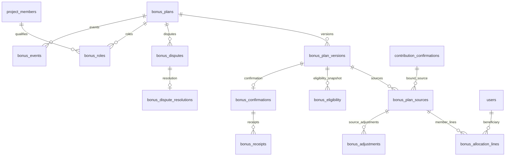

# Phase 06 M1 独立设计评审报告（Proposed，待产品决策）

- 日期：2026-11-19（Asia/Shanghai）
- 分支：`feature/phase06-m1-bonus-design`
- 基线：`develop` af3802b19749daccafff0589c1d7286782944aab（Phase 05 M6 PR #9 已合并）；Schema v7；`main` 未改动
- PR：[#10](https://github.com/YEXIAONAN/Nexora/pull/10)，base `develop`，评审前 Head `82e9364320f92ba421e29e1a62104a4f66d93230`，draft
- 范围：仅设计评审与文档修订；**没有新增表、迁移、Go 代码、API 或 Vue 页面**
- 结论：原稿 5 项 P1 与 5 项 P2 缺口已修订；**补充复审**另发现 2 项 P1 与 2 项 P2 设计缺口（逐来源账本、无独立核定人、状态双轴、资格舍入顺序），已继续修订 [phase-06-m1-design.md](phase-06-m1-design.md)。**D1–D10 与 A1–A5 全部保持 Proposed，未获任何产品批准，禁止进入 M2。**

## 1. 评审结论摘要

| 项目 | 结论 |
| --- | --- |
| 是否错误地把任务权重/单案例份额当作项目级奖金权重 | **未发现**。原设计明确禁止；本轮补充“禁止跨案例累加 bps”的硬性表述。 |
| 是否与 PRD / ADR 0005 / ADR 0007 冲突 | **无直接冲突**；原稿在来源失效、资格默认、职责分离、状态机、金额边界上**不完整**，已按 Phase 05 已批准治理规则补齐。 |
| 是否存在可导致资金争议的设计 | **有**：跨计划重复引用、无资格份额默认处理、来源在确认后失效、未分配余额归属，均已标注并给出推荐，等待产品决定。 |
| 是否存在越权/泄露风险 | **有**：原权限矩阵未写清创建人/调整人/受益人/来源核定人与核定人的回避组合；已补全为可测试的独立核定谓词。 |
| 是否存在历史覆盖或并发重复确认风险 | **有**：原稿只有文字描述，没有版本指针、不可变确认与数据库唯一约束；已补状态机与不变量。 |
| 是否可提交产品批准 | **可以提交评审材料**；但 D1–D10、A1–A5 未签字前不得开始 Schema v8 或金额业务开发。 |
| 本轮是否修改生产代码或迁移 | **否**。只修改 `docs/`。 |

评审严重度定义：

- **P1**：若按原设计直接进入 M2，可能导致资金错分、越权、历史覆盖或无法审计的设计缺口。
- **P2**：不直接造成资金错误，但会造成可解释性、合规或工程实现风险；必须在 M2 前解决或明确接受。

## 2. 基线与证据核实

### 2.1 Git 与 PR

| 检查 | 结果 |
| --- | --- |
| 本地工作区 | 评审开始时 `git status --short` 为空；无未提交修改需要保护 |
| 当前分支 | `feature/phase06-m1-bonus-design`，跟踪 `origin/feature/phase06-m1-bonus-design` |
| 评审前 HEAD | `82e9364320f92ba421e29e1a62104a4f66d93230` |
| `develop` | `af3802b19749daccafff0589c1d7286782944aab`（Merge PR #9） |
| M1 分支提交 | 4 个：`176b5bf`、`da5e5f4`、`bddd439`、`82e9364` |
| PR #10 | OPEN / draft / base `develop` / mergeable |
| Push CI | run [44524163737](https://github.com/YEXIAONAN/Nexora/actions/runs/44524163737)，4 项 SUCCESS |
| PR CI | run [44524219968](https://github.com/YEXIAONAN/Nexora/actions/runs/44524219968)，4 项 SUCCESS |

### 2.2 已核实的 Schema v7 事实

本轮以实际迁移与源码为准，而不是只读历史文档：

1. **正式贡献的唯一读取入口**是 `contribution_effective_shares`，只连接 `effective_confirmed_version_id`、`status='confirmed'` 与确认记录，并排除未决争议（[00007_contributions.sql](../../apps/api/internal/database/migrations/00007_contributions.sql) 第 683–686 行）。
2. **确认必须独立**：`contribution_confirmation_guard` 校验版本为最新 `pending_review`、份额合计 10000、摘要一致，并调用 `contribution_independent`；后者要求有效核定授权、非提案人、非成果作者、非审核人、非份额持有人、无冲突记录（同文件第 230–237、371–384 行）。
3. **历史不可变**：事实表统一由 `contribution_fact_guard` 拒绝 UPDATE/DELETE；版本内容离开 draft 后冻结；确认事件每版本唯一（同文件第 481–496 行）。
4. **成员 epoch**：`project_members.authorization_version` 在状态变化时递增（[00006_submissions_reviews.sql](../../apps/api/internal/database/migrations/00006_submissions_reviews.sql) 第 2–6 行）；核定授权与 `member_authorization_version` 绑定，离队再回归不会恢复旧授权（00007 第 163–165、353–358 行）。
5. **归档门禁只收紧不放宽**：`contribution_archive_guard` 要求每个已验收任务都有有效确认贡献、无未决争议、无工作草稿，且每位份额持有人都有与确认摘要匹配的真实收件证据（00007 第 568–590 行）。
6. **归档后贡献写入被拒绝**：`contribution_lock` 要求项目 `status='active'`，归档项目无法新增贡献、争议或确认（00007 第 173–183 行）。
7. **服务层已有命令幂等模式**：`client_request_id` + 输入摘要 + `audit_events` 重放（[service.go](../../apps/api/internal/contributions/service.go) 第 105–166 行）；但 M6 已记录“告知没有数据库唯一约束，SQL 旁路仍可重复”的残余风险（[phase-05-m6-report.md](phase-05-m6-report.md) §8/§9）。

## 3. 与 PRD / ADR / Phase 05 的一致性核对

| 检查项 | 已批准要求 | 原 M1 设计 | 结论 |
| --- | --- | --- | --- |
| 奖金方案关联团队与项目，记录总额、币种、参与资格、事前约定 | PRD V2.0「奖金分配」 | 有 BonusPlan 概念，但字段不全 | 方向一致，已补字段 |
| 金额使用最小货币单位整数或 `numeric`，明确舍入规则 | PRD V2.0；ADR 0005 金额仍 Proposed | 提到整数与最大余数法，但无币种精度、上限、破平局细节 | **P2-1 / P2-2** |
| 分配合计不得超过可分配金额 | PRD V2.0 | 有文字约束，无精确账务等式 | 已补 §4.3 不变量 |
| 零贡献、无资格、未分配余额必须显式处理 | PRD V2.0 | 只说“不静默重分”，无默认路径 | **P1-2 / P1-3** |
| 最终确认需校验合计，避免重复结算 | PRD V2.0 | 只有 expected_version/idempotency 文字 | **P2-5** |
| 不得把任务权重、代码行数、提交次数、在线时长、角色换算为奖金 | ADR 0005/0007；Phase 05 §1.3 | 原 §1 明确禁止 | **一致，无违规** |
| 不同成果的 `share_bps` 不可直接相加为项目贡献率 | Phase 05 §1.1；ADR 0007 | 方案 A 按案例预算 | 方向一致，已补“禁止跨案例累加 bps” |
| 受益人回避、提案人不得核定、独立核定、无人则等待 | ADR 0007 十八项 | 只写“独立核定”，未列组合 | **P1-4** |
| 正式确认历史不可覆盖 | Phase 05 §2/§5 | 只有“留痕”文字，无版本指针/确认记录 | **P1-5** |
| 归档只读，不放宽 Phase 05 归档约束 | Phase 05 §7 I12；M6 报告 | 说“需单独批准”，未给策略 | **P2-3** |
| ROOT 不自动绕过业务授权 | Phase 06 任务书；ADR 0007 | 只在文字中提及 | **P1-4** |
| 收到结果 ≠ 同意结果 | Phase 05 §7；M6 报告 | 已写“收件与同意不同” | 一致，但缺独立表与唯一约束 |
| 不能复用贡献告知而不说明语义 | M6 报告 §8/§9 | 未说明 | **P2-4** |

## 4. 发现的问题与处置

### 4.1 P1 问题（若直接进入 M2 会阻断）

#### P1-1 来源失效闭包未定义

- **原稿位置**：原 §4 最后两条。
- **问题**：只写了“旧确认被 superseded / overturned 后不能自动继续视为有效依据”，但没有定义在提交、核定、核定后三个时点分别发生什么。若来源贡献在计划核定后被推翻，系统可能继续展示旧金额为“正式”。
- **影响**：资金错分、历史失真、无法回答“这笔钱基于哪一版贡献”。
- **处置**：修订 §2.6、§4.3、§4.4：提交与核定都必须重验来源仍指向当前有效确认、摘要一致、无未决争议；核定后失效不得原地改账，只能通过新版本或正式裁定表达。**核定后的精确业务语义仍需 D9 批准。**

#### P1-2 资格默认与历史成员未定义

- **原稿位置**：原 §2 第 3 条、原 §5。
- **问题**：没有规定“缺少资格决定”时是默认有资格、默认无资格，还是阻止提交；也没有规定已离队的历史份额持有人如何处理。
- **影响**：可能静默排除贡献者，或把奖金发给无资格者；历史成员争议无法追溯。
- **处置**：修订 §2.3、§4.2：默认缺失即不可提交；任何绑定来源的份额持有人必须有显式资格决定；历史成员政策待 D3/D4 批准。**默认值本身仍需产品签字。**

#### P1-3 跨计划重复引用同一贡献确认

- **原稿位置**：原 §2 第 1 条、D1。
- **问题**：D1 允许“一套或多套独立计划”，但没有禁止同一 `confirmation_id` 同时成为两个有效计划的来源。
- **影响**：同一贡献被重复计入两次预算，可能造成重复发放建议。
- **处置**：修订 §2.7、A1：同一确认至多成为一个有效计划的来源；M2 需要数据库级唯一性（建议由触发器维护来源 active 标志 + 部分唯一索引），不能只靠前端。**是否允许多计划仍需 D1 批准。**

#### P1-4 职责分离矩阵不完整

- **原稿位置**：原 §5 六行矩阵。
- **问题**：没有明确“创建人 ≠ 核定人”“调整人 ≠ 核定人”“核定人不得是受益人”“核定人不得是来源贡献的提案人/核定人”“资格审核人不得审核自己”“ROOT 无自动写权限”。原稿只写“与调整、受益关系独立的核定人”，不可测试。
- **影响**：自利核定、Team Owner/ROOT 越权、撤销授权后仍可确认。
- **处置**：修订 §5 为完整矩阵与独立核定谓词；M3 必须服务层与数据库双重执行。**具体角色集合与极小团队例外待 D7/A3 批准。**

#### P1-5 状态机与不可变确认缺失

- **原稿位置**：原 §4、§7 的散文描述。
- **问题**：没有版本状态、派生工作流、`latest_version_id` / `effective_confirmed_version_id`、每版本唯一确认记录、superseded/overturned 的事务约束。
- **影响**：Draft 可能被当作正式金额；修订可能覆盖旧确认；并发可能双重确认。
- **处置**：修订 §4.4，完全对齐 Phase 05 已验证的四层模型；M2 必须用约束触发器实现，不能只在 Go 层判断。**状态词汇与 `cancelled` 语义待产品批准。**

### 4.2 P2 问题（M2 前必须解决或明确接受）

#### P2-1 币种、最小单位与金额上限缺失

- **问题**：原稿只说“比例依币种而定”，没有允许集、最小单位来源、最大预算与溢出边界。
- **影响**：0 位/3 位小数币种处理错误；`budget * 10000` 可能溢出 int64；UI 与 API 对“元/分”理解不一致。
- **处置**：修订 §4.1：ISO 4217 + 最小单位快照、bigint、允许集、`<= 900_000_000_000_000` 上限、API 只收整数最小单位。

#### P2-2 舍入、未分配与人工调整的账务等式不完整

- **问题**：有“最大余数法”和“未分配余额”词汇，但没有精确等式，也没有说明人工调整如何影响来源预算与计划总额。
- **影响**：建议金额与最终金额对不上；余数被隐藏；调整后无法解释差额。
- **处置**：修订 §4.2/§4.3：逐来源最大余数、UUID 字节序破平局、`allocated + source_unallocated = source_budget`、计划级精确等式、调整必须记录前后值与理由。

#### P2-3 归档项目与奖金计划的关系未定

- **问题**：原稿只说“需单独批准”，没有说明奖金计划应在归档前还是归档后创建，也没有说明归档后来源失效如何处理。
- **影响**：可能出现归档后新增财务记录、旧项目被隐式改写，或归档被奖金流程阻塞。
- **处置**：评审报告 D9 给出三种方案；修订 §4.4 明确不得绕过 `contribution_archive_guard`。**推荐默认：奖金计划在项目归档前完成正式核定；若产品要求归档后补录，必须单独批准受限的追加式流程。**

#### P2-4 告知/收件复用风险

- **问题**：原稿列出 BonusReceipt，但没有说明是否复用 `contribution_notifications`。M6 已记录该表没有数据库唯一告知约束、历史告知复用返回 201 的残余风险。
- **影响**：重复告知、旧收件被错误用于新版本、SQL 旁路制造重复。
- **处置**：建议 Phase 06 使用独立的奖金告知/收件表，数据库唯一约束 + 明确 `reused_existing` 语义；不复用贡献告知表，也不因此放宽 Phase 05 归档门禁。

#### P2-5 幂等与唯一约束只在文字层

- **问题**：原稿提到 `client_request_id`，但没有数据库唯一键；确认记录也没有每版本唯一约束。
- **影响**：并发或重试可能产生重复确认/重复调整；SQL 旁路可以绕过 Service。
- **处置**：M2 必须为命令记录、确认记录、来源绑定、告知/收件建立数据库唯一约束；M3 继续使用 expected_version + Team→Plan 锁顺序。

### 4.3 补充复审整改（2026-11-19，本轮仅修设计）

| 级别 | 发现的设计缺口 | 修订后的候选约束 | 产品待批项 |
| --- | --- | --- | --- |
| **P1-6** | 原 ERD 只用 `(plan_version_id,user_id)` 存计划级分配，人工调整缺 `source_id`，不足以证明逐来源资金守恒 | **来源 × 成员**明细作为权威账本，调整逐笔绑定 source_id；成员总额只读聚合，逐来源与计划级等式分别验算 | D2/D4/D6：来源预算和调整范围 |
| **P1-7** | 所有项目成员均为受益人时，内部独立核定候选永远为零 | 保持 `pending_review`；提出**经产品批准才可启用**的单计划、限时、核验身份且权限最小化的外部独立核定授权；外部人也必须通过完全相同回避谓词 | D7/A3：是否允许外部独立核定、授权主体/核验/撤销 |
| **P2-6** | `confirmed → disputed` 在“版本转换”表中把派生计划工作流误写成版本状态 | 拆成两张状态表；收到异议只新增争议记录，**confirmed 版本及核定事实保持不变**；撤回待核定版本须 abandoned + 新 draft | D8/D9：争议与推翻政策 |
| **P2-7** | 无资格持有人参与最大余数法的先后顺序未明确，过滤后可能多给合格者 1 最小单位 | **所有正式份额持有人先舍入，再按资格分流**；无资格份额的 raw 结果进入来源未分配；加入 1 单位并列且低 UUID 无资格的反例 | D4/D6：未分配余额是否可核定 |

上述四项只代表**设计整改完成**，不代表 Schema/API 已实施或资金规则获批准。

## 5. 概念 ERD（候选，不是已实施表结构）

| 对象 | 关键字段 | 必须的约束（候选） |
| --- | --- | --- |
| `bonus_plans` | id, team_id, project_id, purpose, currency_code, currency_minor_unit, total_budget_minor, latest_version_id, effective_confirmed_version_id, status, created_by | `UNIQUE(team_id,project_id,id)`；复合外键到 `projects`；币种与预算 CHECK；指针同计划 |
| `bonus_plan_versions` | id, plan_id, version, status, total_budget_minor, currency/minor_unit_snapshot, plan_unallocated_minor, supersedes_version_id, input_digest, algorithm_version, created_by, reason | `UNIQUE(plan_id,version)`；`UNIQUE(plan_id,client_request_id)`；仅 draft 可改内容；状态转换触发器 |
| `bonus_plan_sources` | id, plan_version_id, case_id, case_version_id, confirmation_id, confirmation_digest, source_budget_minor, source_unallocated_minor, coverage_decision, reason, shares_snapshot, is_active | 复合外键到贡献基础表；`confirmation_digest` 必须等于确认摘要；`is_active` 部分唯一索引防止跨计划重复 |
| `bonus_eligibility` | plan_version_id, user_id, decision, reason, decided_by, member_epoch, decided_at | `UNIQUE(plan_version_id,user_id)`；决定人 ≠ 本人；epoch 必须与 `project_members.authorization_version` 一致 |
| `bonus_allocation_lines` | plan_version_id, source_id, user_id, bps, raw_rounded_minor, eligible_suggested_minor, final_minor, eligibility_decision_id, remainder_rank | **UNIQUE(plan_version_id,source_id,user_id)**；source_id 同版本同范围；ineligible final=0；逐来源守恒；建议与最终不同必须有 source-linked 调整 |
| `bonus_confirmations` | plan_version_id UNIQUE, confirmed_by, confirmed_at, rationale, version_digest, request_id | 不可变；独立核定触发器；摘要必须匹配重算结果 |
| `bonus_adjustments` | plan_version_id, source_id, user_id, old_minor, new_minor, delta_minor, old/new_source_unallocated_minor, reason, actor_id, request_id | 追加式；来源与分配行一致；必须给出理由且逐来源守恒，不得改其他来源 |
| `bonus_disputes` / `bonus_dispute_resolutions` | 争议版本、理由、裁定、裁定人 | 不可变；裁定人独立；推翻必须生成后继草案 |
| `bonus_roles` | plan_id, user_id, role, member_epoch (内部), grant_version/expiry (外部), granted_by, status, reason | 禁止自我授权；内部 epoch 变化失效；外部候选必须先经 D7/A3 批准，身份校验、单计划最小权限、到期/撤销；追加式历史 |
| `bonus_notices` / `bonus_receipts` | plan_version_id, confirmation_id, recipient_id, digest, channel, acknowledged_at | 追加式；每收件人唯一；摘要必须匹配确认版本；不复用贡献告知表 |
| `bonus_events` | plan_id, plan_version_id, event_type, actor_id, reason, request_id | 追加式；写 `audit_events`；禁止 UPDATE/DELETE |

**成员汇总只读投影**：`bonus_member_totals(plan_version_id,user_id,total_minor)` 必须由 `SUM(bonus_allocation_lines.final_minor)` 计算；不得增设一个可独立编辑且与来源明细可能分歧的“总分配额”表。资金快照必须同时保存每个来源的 `source_unallocated_minor` 与计划版本的 `plan_unallocated_minor`。

## 6. 状态机与数据完整性

完整状态机见修订后的 [phase-06-m1-design.md](phase-06-m1-design.md) §4.4。评审要求 M2 至少实现以下不变量：

| # | 不变量 |
| --- | --- |
| B1 | `effective_confirmed_version_id` 为 NULL 或指向本计划 `status='confirmed'` 且有唯一确认记录的版本。 |
| B2 | `latest_version_id` 单调递增且指向本计划最大版本，永不回退。 |
| B3 | 核定只能针对 `latest_version_id` 且 `status='pending_review'` 的版本。 |
| B4 | `superseded` 只能由更新版本的确认事务产生，且存在后继 confirmed 版本。 |
| B5 | `overturned` 必须存在 overturn 裁定；有效指针被清空；同一事务生成后继 draft。 |
| B6 | 每个计划版本至多一条确认记录；确认、裁定、调整、收件不可变。 |
| B7 | 版本内容离开 draft 后不可变；来源、资格、分配仅在父版本 draft 可写。 |
| B8 | **每来源** `Σ final(source,user)+source_unallocated(source)=source_budget(source)`；**计划** `total=Σ所有来源 final+Σ来源未分配+plan_unallocated`，精确相等且全部非负。 |
| B9 | `Σ source_budget <= total`；来源预算、分配、未分配均非负。 |
| B10 | 来源必须指向当前有效确认、摘要匹配、无未决争议；提交与核定各重验一次。 |
| B11 | 绑定来源中的每位份额持有人必须有显式资格决定；缺失即拒绝提交。 |
| B12 | 核定人满足独立谓词；无合格人时保持 pending，不自动兜底。 |
| B13 | 授权与成员 epoch 绑定；撤销、离队、重新加入后旧授权不可用。 |
| B14 | 计划工作流状态由权威字段派生并被数据库校验；客户端不可写。 |
| B15 | 归档项目不得绕过 Phase 05 归档门禁；奖金写入不得修改贡献历史。 |
| B16 | 命令、确认、来源 active、收件均有数据库唯一约束；重放返回既有结果。 |
| B17 | 权威明细键为 `(plan_version_id,source_id,user_id)`；人工调整必须包含 source_id；成员总额只能从逐来源行派生。 |
| B18 | **全部**确认份额持有人先按 LRM 得到 `raw_rounded`（Σ = source_budget），然后按资格分流；不允许先过滤无资格人。 |
| B19 | `disputed/revising` 是**计划工作流**而非版本状态；打开争议不改 confirmed 版本；撤回 pending_review 不返回 draft，而 abandoned 后另建 draft。 |
| B20 | 无内部独立人时保持 pending；外部 reviewer 若经 D7/A3 批准，必须计划级、限时、身份核验、可撤销、最小权限且同等 COI。 |

## 7. 权限与职责分离（内部和候选外部两条路径）

完整矩阵见修订后的设计 §5。独立核定谓词必须同时满足：

1. 经身份核验、持有**针对该具体奖金计划**的有效核定授权，且满足两类**互斥可核验路径之一**：**内部**为有效 Team/Project 成员并匹配当前成员 epoch；**外部**仅在 D7/A3 事先获批后通过可撤销、限时、版本化的单计划证据审阅/确认授权，不能藉此获得通用 Team/Project 成员身份或横向读取权限。
2. 不是计划创建人、当前版本人工调整人或本人资格决定人。
3. 不是该计划任何经济受益人（包含可能受本计划金额变化影响的利益关系，不可只靠把 `final_minor` 改为 0 来规避）。
4. 不是任一绑定来源的贡献提案人、贡献核定人或贡献争议裁定人。
5. 无其他已声明或应当声明的利益冲突；确认事务中实时重验身份、授权撤销/期限、来源有效性、账务守恒与上述回避谓词。
6. 服务层拒绝非法请求，数据库再次验证；若没有合法候选人，保持 `pending_review`，不得自动指派、将 ROOT 当兜底，或用所有受益人的会签取代独立核定。

**小团队可行性**：若 ZERO_R 的实际项目所有候选内部核定人都同时是受益人，这不是程序 bug，而是一个真实制度死锁。候选方案是产品负责人明示批准一名**外部独立自然人**的限时单计划核定授权（只可读作决定所需的最小来源证据与奖金方案，不可浏览其他 Team/Project）；未批准前继续 pending。任何外部通道都必须有授予/拒绝/撤销审计及到期权限测试。

访问隔离：所有奖金对象带复合 Team/Project 作用域；跨 Team/Project IDOR 不得泄露对象存在性；本人结果接口仅返回本人来源及金额明细，计划整体和其他人金额需要独立授权；ROOT 不隐式具备奖金写权限。

## 8. 金额候选模型与边界案例

### 8.1 任务书示例验算

项目总预算 10000 元；成果 A 预算 6000 元，甲 6000 bps、乙 4000 bps；成果 B 预算 4000 元，甲 3000 bps、乙 7000 bps。

| 来源 | 预算（分） | 成员 | bps | 基础金额（分） | 余数 | 最终建议（分） |
| --- | --- | --- | --- | --- | --- | --- |
| A | 600000 | 甲 | 6000 | 360000 | 0 | 360000 |
| A | 600000 | 乙 | 4000 | 240000 | 0 | 240000 |
| B | 400000 | 甲 | 3000 | 120000 | 0 | 120000 |
| B | 400000 | 乙 | 7000 | 280000 | 0 | 280000 |

合计：甲 480000 分（4800 元），乙 520000 分（5200 元），总计 1000000 分（10000 元）。这是模型示例，不是已批准政策。

### 8.2 边界案例

| # | 场景 | 期望行为 |
| --- | --- | --- |
| 1 | 总预算 0 | 允许建立计划；不能产生正金额；确认需显式零分配理由。 |
| 2 | 来源预算 0 | 允许“纳入但零预算”，必须填理由；不得自动当作排除。 |
| 3 | 预算 1 分、两个 5000 bps 份额 | 基础均为 0，余数并列；按 UUID 字节序升序，较小者得 1 分，另一人 0 分。 |
| 4 | 预算 100 分、3333/3333/3334 bps | 基础 33/33/33，剩余 1 分给余数最大的 3334 份额。 |
| 5 | 0 位小数币种（JPY） | 以元为最小单位；算法不变；不得强行补两位小数。 |
| 6 | 3 位小数币种（KWD） | 以第纳尔千分之一为最小单位；API 仍只收整数。 |
| 7 | 无资格份额 | **先按全部份额舍入，再分流**：无资格者原始金额进入来源未分配；不得预过滤重分。 |
| 8 | 来源内全部无资格 | 不生成建议；必须显式未分配或经批准调整。 |
| 9 | 历史离队份额持有人 | 是否可获奖待 D3；未批准前不得静默删除或自动转入他人。 |
| 10 | 同一确认被两个计划引用 | 若 A1 批准，第二个计划必须被数据库拒绝；不得只在前端提示。 |
| 11 | 来源在提交与核定之间被 superseded | 拒绝核定，要求新版本；不得沿用旧金额。 |
| 12 | 来源被 overturned 后计划已确认 | 不得原地改账；只能通过新版本/裁定表达；具体状态待 D9。 |
| 13 | 预算或来源金额超上限 | 数据库与服务层同时拒绝，避免 `budget * 10000` 溢出。 |
| 14 | 人工调整使总额不等于预算 | 拒绝提交/核定；未分配余额必须显式。 |
| 15 | 调整使某成员金额为负 | 拒绝；金额只允许非负整数。 |
| 16 | 并发双确认 | 仅一个成功；另一个返回冲突或既有结果；不得产生两条确认。 |
| 17 | 重放同一 `client_request_id` | 返回既有结果，不重复写事实、不重复审计。 |
| 18 | 核定人同时是受益人 | 数据库拒绝；不得仅靠 UI 隐藏按钮。 |
| 19 | 重叠受益人在 A/B 两来源，人工只调整计划汇总 | 缺少 source_id 的修改必须拒绝；A/B 两条来源分别守恒，成员合计只读求和。 |
| 20 | 来源 A 人工调整甲 -10/乙 +10 | A 600/400→590/410，B 300/700 不变；A、B 各合计 1000；总额 2000。 |
| 21 | 预算 1 最小单位、5000/5000、较小 UUID 无资格 | 原始舍入 1 属于该无资格者并进 `source_unallocated=1`；合格者建议 0；先过滤导致合格者得 1 的实现必须失败。 |
| 22 | 全部内部成员都有经济利益，无独立核定候选 | 计划保持 pending_review；外部未正式授权前不能确认，也不能 ROOT/Team Owner 自动兜底。 |
| 23 | 允许的外部审查者授权已过期或被撤销 | 请求被拒绝；不得查询其他 Team/Project；外部身份核验及限时授权均留审计。 |
| 24 | 已确认计划出现未决异议，或撤回 pending | 版本仍为 confirmed、仅工作流 disputed；撤回 pending 必须 abandoned 并新建递增 draft。 |

### 8.3 两来源调整与无资格舍入的可复现算例

**逐来源调整（单位均为最小货币单位）**：

| 来源 | 甲原建议 | 乙原建议 | 甲最终 | 乙最终 | 来源未分配 | 来源总预算 |
| --- | ---: | ---: | ---: | ---: | ---: | ---: |
| A | 600 | 400 | 590 | 410 | 0 | 1000 |
| B | 300 | 700 | 300 | 700 | 0 | 1000 |
| **只读总额** | **900** | **1100** | **890** | **1110** | **0** | **2000** |

A 的调整必须有两条绑定 `source_id=A` 的不可变记录（甲 -10，乙 +10）；B 没有改变；来源 A/B 各自为 1000，计划为 2000。若只改甲的 plan-level total=890、无法解释对应 A 来源的另一条调整，则数据模型无法证明守恒，须拒绝进入 M2。

**资格舍入（1 单位）**：两个持有人各 5000 bps，UUID 较小者无资格。先对两人计算，原始结果 1/0；随后资格分流，合格者得到 0，无资格者 1 单位记入来源未分配。不得先过滤无资格者后对唯一合格者分配 1 单位。

## 9. D1–D10 逐项评审

### D1 奖金方案与 Team/Project 的作用域

- **已有约束**：PRD 要求方案关联团队与项目；v7 所有业务对象使用 `(team_id, project_id)` 复合作用域，项目唯一键为 `UNIQUE(team_id,id)`。
- **推荐**：每个计划严格绑定一个 Team + Project；同一项目默认只允许一个当前有效计划；如产品允许多计划（例如不同资金批次），必须保证同一 `confirmation_id` 至多成为一个有效计划的来源。
- **备选**：A. 每项目仅一个计划（最简单）；B. 多计划共享来源池 + 显式消费台账（复杂，不建议首版）。
- **优点与代价**：单计划模型最易审计、无重复计入；多计划灵活但需要来源唯一性与跨计划总额校验。
- **风险**：多计划重复计入、跨 Team 访问、计划与项目归档顺序冲突。
- **DB/API 影响**：复合外键；`latest_version_id`/`effective_confirmed_version_id`；来源 active 部分唯一索引；API 路径挂在 `/projects/{projectID}/bonus-plans` 下。
- **待产品决定**：是否允许多计划；同一确认是否允许跨计划重复计入；如何定义“同一资金用途”。

### D2 不同成果价值及预算分配方式

- **已有约束**：Phase 05 的 10000 bps 只在一个已验收案例内部有效；ADR 0007 明确不批准跨任务价值指数；PRD 要求“引入已确认贡献，生成可解释建议”。
- **推荐**：方案 A，授权人逐案例填写来源预算；每个有效确认案例必须“纳入并给预算”或“明确排除并填理由”；不设计综合指数。
- **备选**：A. 项目级统一权重（需要新的可解释指数与审核机制，暂不建议）；B. 按人数均分（会把贡献差异抹平，不建议）；C. 外部公式导入（不可审计，不建议）。
- **优点与代价**：方案 A 可解释、可复现、能回答“钱为什么给这个案例”；代价是预算由人决定，可能受谈判影响。
- **风险**：预算被用作排除工具；来源覆盖遗漏；同一案例预算在不同计划中不一致。
- **DB/API 影响**：`bonus_plan_sources` 保存预算、纳入/排除决定、理由与份额快照；预览 API 返回逐案例解释；确认摘要覆盖来源预算。
- **待产品决定**：是否允许排除案例；是否要求覆盖项目全部有效确认案例；预算是否可为零；预算修改是否必须新版本。

### D3 成员奖金资格

- **已有约束**：PRD 区分团队成员、项目参与资格与奖金资格；Phase 05 要求份额持有人引用真实 `project_members` 行；`project_members` 软删除且保留历史；v6 有成员 epoch。
- **推荐**：每个计划版本对每个绑定来源的份额持有人做显式资格决定（合格/不合格），记录决定人、理由、成员 epoch；缺失即拒绝提交；决定人不得决定自己的资格；历史离队成员是否可获奖需产品决定。
- **备选**：A. 所有有效份额持有人自动有资格（简单，但违反三概念分离）；B. 仅当前 active 成员有资格（会静默排除历史贡献者）；C. 项目级资格复用（减少重复，但计划间可能不一致）。
- **优点与代价**：显式决定可审计、可解释；代价是每次计划都需人工审核，历史成员处理复杂。
- **风险**：静默排除、关系户、离队成员无法送达、epoch 变化导致资格失效。
- **DB/API 影响**：`bonus_eligibility` 按计划版本快照；epoch 校验；资格列表与决定 API；确认摘要覆盖资格快照。
- **待产品决定**：默认是“缺失即无资格”还是“缺失即阻止提交”；历史成员是否可获奖；资格按计划还是按项目复用；谁有权批准资格。

### D4 无资格贡献份额处理

- **已有约束**：Phase 05 要求份额合计 10000；没有奖金规则；PRD 要求零贡献、无资格、未分配余额显式处理。
- **推荐**：必须对**全部**正式份额先执行整数最大余数舍入，再根据明确资格决定分流；无资格者的原始舍入金额进入显式来源未分配。若授权人要转给合格受益人，必须**按来源**做有理由的调整记录；来源未分配与计划未分配都必须展示。
- **备选**：A. 自动按剩余合格者比例重分（最危险，不建议）；B. 直接丢弃该份额（会导致合计不守恒，不允许）；C. 阻止整个计划提交直到人工处理（可作为更严格默认）。
- **优点与代价**：显式未分配最安全、可解释；代价是需要人工决策，可能留下余额。
- **风险**：余额被隐藏、被二次分配、贡献者争议、总额不守恒。
- **DB/API 影响**：`source_unallocated_minor`、`plan_unallocated_minor`、调整记录；确认前校验等式；API 必须显示未分配原因。
- **待产品决定**：默认是“阻止提交”还是“允许显式未分配”；确认时是否允许存在未分配余额；未分配余额的最终归属。

### D5 币种、最小单位与金额精度

- **已有约束**：ADR 0005 金额部分仍 Proposed；PRD 允许最小货币单位整数或 `numeric`；没有批准的币种允许集。
- **推荐**：单计划单币种；ISO 4217 代码 + 最小单位快照；金额 `bigint`；币种允许集、最小单位与最大预算由产品批准；API 只收整数最小单位；不使用浮点。
- **备选**：A. `numeric(20,4)`（需要批准精度，前端处理复杂）；B. 多币种 + 汇率（超出本阶段，不建议）；C. 所有币种强制两位小数（错误，违反任务书）。
- **优点与代价**：整数最小单位精确、可复现；代价是 UI 必须正确换算，币种配置需要维护。
- **风险**：0/3 位小数币种错误、溢出、API 与 UI 单位不一致、跨币种误加。
- **DB/API 影响**：`currency_code`、`currency_minor_unit`、`bigint`、CHECK 上限；API 明确字段单位；OpenAPI 使用整数格式并注明最小单位。
- **待产品决定**：币种允许集；每币种最小单位；最大预算；是否允许未来扩展多币种计划。

### D6 舍入与未分配余额

- **已有约束**：ADR 0005 提到最大余数法但未批准；Phase 05 没有金额；任务书要求评估最大余数法、余数归属、平局与资格例外。
- **推荐**：逐来源、对全部份额持有人先执行最大余数法；平局按 UUID 字节序升序；**舍入后再按资格分流**；算法版本与输入摘要固化；调整必须来源可追溯、逐来源与全计划同时守恒。
- **备选**：A. 只向下取整，余数全部进未分配（简单但对个人不公平）；B. 核定人手工调平（不可复现）；C. 计划级统一舍入（会让逐案例预算失真）。
- **优点与代价**：逐来源舍入保证每个案例预算精确守恒、可解释；代价是不同案例的 1 分归属需要稳定规则。
- **风险**：跨平台破平局不一致、建议与最终金额对不上、未分配被隐藏。
- **DB/API 影响**：保存 `algorithm_version`、`remainder_rank`、输入摘要；确认时重算并比对；API 返回逐人余数解释。
- **待产品决定**：是否采用最大余数法；余数归属；破平局规则；确认时是否允许未分配余额。

### D7 独立核定权限及回避

- **已有约束**：ADR 0007 要求受益人回避、提案人不得核定、单人独立核定、无人独立则等待、授权范围明确；Phase 05 已有 `contribution_independent` 谓词；没有奖金角色。
- **推荐**：新建显式奖金角色（编辑/预算/资格/核定）；核定人必须满足严格回避。**内部**候选必须是有效 Team/Project 成员且授权 epoch 一致；**外部**候选仅在 D7/A3 正式批准后可通过经身份核验、单计划限时、可撤销、最小证据范围授权参与；无人合格则保持 `pending_review`。ROOT 与 Team Owner/Admin/Project Lead 不自动获得权限。
- **备选**：A. 复用贡献核定人（同一人控制贡献与金额，不建议）；B. 项目负责人自动核定（违反回避原则，不建议）；C. 经独立资格审查后授予外部计划级核定权（**推荐产品评估，未批准**）；D. 全部受益人会签（不能消除利益冲突，不应作为默认例外）。
- **优点与代价**：显式角色 + 独立谓词可审计、可测试；代价是小团队可能无人可核定，需要产品接受“长期待核定”。
- **风险**：合谋、授权撤销后仍确认、成员离队/重返 epoch、极小团队死锁、ROOT 越权。
- **DB/API 影响**：`bonus_roles`、确认触发器、授权 API、冲突声明；确认事务重验 epoch；错误码区分未授权/冲突/无候选人。
- **待产品决定**：角色集合、来源贡献核定人与奖金核定人能否兼任、ROOT 策略、是否准许外部独立核定、外部身份与授予主体、授权期限/撤销/证据范围，以及无外部候选时的 pending 期限；**不允许自动例外**。

### D8 本人确认、异议与修订

- **已有约束**：Phase 05 收件证据是“本人持有有效会话并明确确认指定摘要”，不等于同意；争议只针对有效确认，裁定人独立；归档后普通接口禁止补记争议。
- **推荐**：奖金收件与同意分离；默认不要求成员同意才生效；核定后本人可查看正式金额；争议只针对有效版本，裁定维持/推翻；推翻清空有效指针并生成新版本；离队成员送达需独立安全方案。
- **备选**：A. 必须本人明确同意才生效（更强，但会阻塞发放，需产品批准）；B. 超时视为同意（不建议，违反“收到≠同意”）；C. 不做收件记录（不可审计，不建议）。
- **优点与代价**：收件/同意分离符合 Phase 05 经验；代价是“已送达”不等于“无异议”，需要争议窗口政策。
- **风险**：收件被误当同意、旧收件用于新版本、离队成员无法送达、争议无限期。
- **DB/API 影响**：独立 `bonus_notices`/`bonus_receipts`/`bonus_disputes`；摘要绑定；数据库唯一约束；本人结果 API 只返回本人。
- **待产品决定**：是否要求同意；异议窗口；谁可提异议；归档后是否允许异议；离队成员送达方案。

### D9 归档及贡献来源失效后的处理

- **已有约束**：Phase 05 归档门禁要求全部已验收任务有有效确认贡献、无未决争议、无工作草稿、逐人真实收件；归档后 `contribution_lock` 拒绝写入；PRD 要求归档只读。
- **推荐**：不放宽 v7 归档门禁；奖金计划默认在项目归档前完成正式核定；提交/核定重验来源；核定后来源失效不得原地改账，只能用新版本/裁定表达；归档后奖金写入需单独批准，且不得修改贡献数据。
- **备选**：A. 扩展 v8 归档门禁，要求奖金计划已核定（更强，但会追溯影响旧项目与 Phase 05 归档语义）；B. 完全禁止归档后奖金操作（最保守）；C. 允许归档后受限追加式补录（需要独立审计与产品批准）。
- **优点与代价**：不改 v7 最安全、不追溯破坏历史；代价是归档后补录能力受限，可能需要产品接受“先核定后归档”。
- **风险**：归档后新增财务记录、来源失效导致旧金额仍显示、审计断层、追溯阻塞旧项目。
- **DB/API 影响**：奖金域自己的锁与归档策略，不能直接复用 `contribution_lock` 的 active 校验；来源校验读取 `contribution_effective_shares`；禁止对视图建外键。
- **待产品决定**：奖金计划必须在归档前还是可归档后；是否扩展归档门禁；来源被推翻后的计划状态与补救流程。

### D10 系统记录与实际支付的边界

- **已有约束**：PRD 明确系统只核算与记录，不执行真实支付；Phase 05 没有支付表；任务书明确不实现支付、银行账户、转账、税务。
- **推荐**：只记录“建议/待核定/已核定”的内部金额；不引入“已支付”状态、不存银行账户、不生成转账指令；导出必须带“内部记录，非付款凭证”水印；法律/税务合规不在范围。
- **备选**：A. 增加手工“已支付”标记（当前不建议，容易让用户误以为系统完成结算）；B. 增加付款参考号字段（可后续单独批准，但不属于 Phase 06 最小闭环）。
- **优点与代价**：边界清晰、避免虚假财务承诺；代价是产品若需要线下付款跟踪，需要另立模块。
- **风险**：用户把“已核定”理解为“已付款”；争议时无法证明实际支付；未来扩展需要迁移。
- **DB/API 影响**：不建支付表；状态词汇避免 `paid/settled`；API/UI 文案明确“内部核定结果”。
- **待产品决定**：是否需要任何付款状态；导出是否允许；对外沟通口径。

## 10. 测试矩阵（M2–M6 必须覆盖）

本轮是设计阶段，除文档 CI 外**没有执行任何金额或数据库测试**；以下均为计划项，当前状态 **Not Tested**。

| 层级 | 场景 | 关键断言 | 失败先行 |
| --- | --- | --- | --- |
| 单元（Go） | 逐来源最大余数、并列余数、0/1 分、极端预算 | **全体份额先舍入、资格后分流**，原始合计等于来源预算；低 UUID 无资格且预算 1 单位时，合格者 0、来源未分配 1 | 是 |
| 单元（Go） | 0/2/3 位小数币种、非法币种、超上限 | 拒绝或精确换算；无浮点 | 是 |
| 数据库 | 复合作用域外键、跨 Team/Project 挂接 | 插入被拒绝；查询 404 | 是 |
| 数据库 | 来源必须指向有效确认、摘要匹配、无未决争议 | 伪造/旧确认被拒绝 | 是 |
| 数据库 | 来源 active 唯一性（A1 若批准） | 第二计划插入失败 | 是 |
| 数据库 | 金额非负、总额等式、来源预算合计 | 分别验证每个 source、整计划两层资金守恒；拒绝只写成员汇总或无 source_id 的调整 | 是 |
| 数据库 | 两来源重叠成员、仅调整来源 A | `UNIQUE(plan_version_id,source_id,user_id)`；A 590/410、B 300/700，总额 2000 | 是 |
| 数据库 | 状态转换、确认唯一、superseded/overturned | 非法版本状态被拒绝；争议不改 confirmed 版本；pending 撤回必须 abandoned + 新 draft | 是 |
| 数据库 | 历史表 UPDATE/DELETE | 全部被拒绝 | 是 |
| 数据库 | 授权 epoch、撤销、离队重返 | 旧授权不可用 | 是 |
| 数据库 | 受限应用角色 | 不能绕过触发器/DDL | 是 |
| API | 未登录、无效/撤销/过期 Session、CSRF | 401/403，无数据泄露 | 是 |
| API | 跨 Team/Project IDOR、ROOT 越权 | 404/403，不泄露存在性 | 是 |
| API | 重放同一 `client_request_id` | 返回既有结果，不重复写 | 是 |
| API | 不同请求 ID 的同一意图 | 不产生重复确认/调整 | 是 |
| API | 提交/核定期间来源被推翻 | 409/冲突，要求新版本 | 是 |
| API | 资格缺失、历史成员、无资格份额 | 拒绝提交或显式未分配，不静默重分 | 是 |
| API | 核定人=创建人/调整人/受益人/来源核定人 | 全部拒绝 | 是 |
| API | 所有内部成员受益、无独立核定人 | 方案保持 pending_review，不自动兜底；外部通道未经批准不可用 | 是 |
| API | 经批准的外部独立核定授权（D7/A3） | 单计划证据权限，核验身份，过期/撤销拒绝，跨 Team 404，行为留审计 | 是 |
| 并发 | 双确认、调整与确认竞争、撤权与确认竞争 | 仅一个成功；无死锁/超时 | 是 |
| E2E | 验收→贡献→计划→来源预算→资格→建议→调整→核定→本人结果 | 全链路真实数据；正式金额可追溯 | 是 |
| E2E | 收件→异议→裁定→修订→重新核定 | 旧版本保留；新版本重新收件 | 是 |
| E2E | 归档前奖金核定；归档后只读 | 不放宽贡献归档门禁 | 是 |
| 恢复 | 数据库 + 附件 + 奖金/贡献历史联合恢复 | 摘要、金额、审计一致 | 是 |
| 性能 | 大量来源/分配的分页与查询计划 | P95、索引、锁等待有数据 | 是 |
| 安全 | 日志不含 Session/Cookie/金额敏感细节 | 无凭据泄露 | 是 |

## 11. M2–M6 分期与验收门禁

### M2：Schema v8（仅追加）

- 进入条件：D1–D10 与 A1–A5 已批准；原 P1 及补充 P1-6/P1-7 已关闭；**逐来源 × 成员权威账本、调整来源、舍入后资格分流、版本/计划双状态机、无独立核定人的策略**均冻结；金额算法、币种、上限冻结。
- 交付：追加迁移（不改 00001–00007）；BonusPlan/Version/Source/Eligibility/Allocation/Confirmation/Adjustment/Dispute/Notice/Receipt/Role/Event；复合外键、延迟约束触发器、部分唯一索引、金额 CHECK、不可变事实触发器、受限数据库角色。
- 验收：迁移从 v7 干净升级；伪造来源、跨租户、重复确认、历史改写全部被数据库拒绝；`contribution_archive_guard` 行为不变。

### M3：Go Backend + OpenAPI

- 进入条件：M2 合并；Schema 评审通过；权限矩阵批准。
- 交付：Repository/Service/Handler/DTO/权限中间件/状态转换/金额计算/幂等/冲突/OpenAPI 生成类型。
- 验收：金额建议可解释且确定性；不得自动核定/支付；手工调整必须留痕；`-race` 集成测试通过。

### M4：Vue 奖金管理工作台

- 进入条件：M3 API 契约冻结。
- 交付：计划入口、预算与币种表单、来源证据、资格管理、建议/调整对比、核定工作台、本人结果、历史与争议。
- 验收：清晰区分建议/草案/正式确认；不显示虚假“已支付”；沿用 Nexora 灰白风格；无蓝紫渐变堆叠。

### M5：可靠性与安全加固

- 进入条件：M4 功能可用。
- 交付：失败先行回归（舍入、溢出、零预算、重复提交、并发核定、撤权、IDOR、资格冲突、版本失效、历史不可变、审计原子性）。
- 验收：先复现再修复；全部关键安全结论有自动化证据。

### M6：综合验收

- 进入条件：M5 缺陷关闭。
- 交付：真实 PostgreSQL 17 + Go + Vue + Playwright 全链路；`make verify`、Go 全量 `-race`、Vitest、Playwright、容器构建、Secret Scan、数据库+附件恢复、性能/并发专项。
- 验收：区分 Pass / Fail / Not Tested；不得用“CI 全绿”替代系统级验收；不自动合并、不进入发布。

## 12. 待批决策表

| ID | 待决问题 | 推荐 | 若未决的后果 | 阻断 M2 |
| --- | --- | --- | --- | --- |
| D1 | 每项目允许一个还是多个计划；同一确认能否跨计划重复引用 | 默认单计划；多计划则来源全局唯一 | 重复计入资金、审计歧义 | 是 |
| D2 | 是否采用逐案例人工预算；是否允许排除案例 | 采用；必须覆盖或明确排除 | 无法解释跨成果价值 | 是 |
| D3 | 资格默认、历史成员、批准人 | 缺失即阻止提交；历史成员待批 | 静默排除或错发 | 是 |
| D4 | 无资格份额默认处理；确认时是否允许未分配 | 显式未分配；不自动重分 | 资金争议、合计不守恒 | 是 |
| D5 | 币种允许集、最小单位、最大预算 | ISO + 最小单位快照；bigint；上限 | 精度错误、溢出 | 是 |
| D6 | 最大余数法、余数归属、破平局 | **全部份额先 LRM，再资格分流**；逐来源 UUID 字节序；调整逐来源守恒 | 不可复现、无资格份额错分 | 是 |
| D7 | 角色集合、独立核定谓词、ROOT 策略 | 显式角色；严格独立；**外部单计划核定须另行批准**；ROOT 无写权限 | 自利核定、越权、全受益团队无核定人 | 是 |
| D8 | 是否要求同意、异议窗口、离队送达 | 收件≠同意；默认不要求同意 | 虚假同意、无法送达 | 是 |
| D9 | 归档前/后奖金操作；来源失效后的计划状态 | 归档前核定；不改 v7 门禁 | 历史覆盖、旧金额残留 | 是 |
| D10 | 是否记录任何付款状态 | 不记录；仅内部核定 | 虚假付款承诺 | 是 |
| A1 | 同一确认跨计划唯一性 | 全局唯一 | 重复发放 | 是 |
| A2 | 来源覆盖完整性 | 必须纳入或明确排除 | 遗漏贡献 | 是 |
| A3 | 极小团队无独立核定人 | 无合法核定人则 pending；建议产品批准后可启用**限时/可撤销/独立外部审计人**，不可自动例外 | 自批或长期阻塞 | 是 |
| A4 | ROOT 平台支持访问 | 无写权限；只读需审计 | 平台越权 | 是 |
| A5 | 是否要求逐人收件才归档/导出 | 需产品批准；未批准不声称送达 | 归档证据不足 | 是 |

## 13. 本轮变更、CI 与最终结论

- 修改文档：`docs/development/phase-06-m1-design.md`（修订）、`docs/development/phase-06-m1-review.md`（新增）、`docs/development/roadmap.md`、`docs/product/product-requirements.md`（仅当前状态）。
- 未修改：`main`、`develop`、任何历史迁移、任何业务代码、任何运行中的数据库。
- 提交与 CI：本次修订的提交 SHA 与 CI run ID 记录在 §13.1；后续仅追加文档证据，不改业务代码。
- **最终结论**：M1 独立设计评审**完成**，可以提交产品负责人逐项决策；D1–D10 与 A1–A5 全部保持 **Proposed**。在获得明确批准前，**不得开始 Schema v8、不得开发金额业务 API、不得把任何草案金额视为正式结果**。

### 13.1 评审修订与 CI 证据

- 修订提交：`14032e3`（`docs(phase06): complete M1 independent design review`）
- Push CI：[44526507074](https://github.com/YEXIAONAN/Nexora/actions/runs/44526507074)，Backend (Go)、Frontend (Vue)、Secret scan、Containers 四项 pass
- PR CI：[44526516108](https://github.com/YEXIAONAN/Nexora/actions/runs/44526516108)，四项 pass
- PR HEAD 更新为 `14032e3`；PR #10 仍为 draft，未合并，未自动进入 M2。

### 13.2 补充评审整改交付（2026-11-19，仍为 Proposed）

- PR #10 补充评审的 **P1-6、P1-7、P2-6、P2-7** 已全部反映到概念模型、金额不变量、两层状态机、权限矩阵、具体算例、D7/A3 和测试矩阵；没有将外部核定或资金分配政策改为 Accepted。
- 本次只修改 M1 设计文档及本评审报告；不新增 Schema v8、金额业务 API、Vue 页面或运行中的数据库操作。
- 此前 §13.1 为**历史 CI 检查点**，不代表本次整改后的 HEAD；本次整改提交及最新 CI 以 PR #10 当前 Head 和其对应 Actions 运行结果为准。
- **M2 继续阻断**：逐来源账本和外部核定方案仍是待批准设计，并非已实施保证。